<p align="center">
  
</p>

<p align="center">
  <b>Plateforme d'IA pour le contentieux fiscal tunisien</b><br>
  Hackathon national « IA &amp; Finances publiques » 2026 · Défi principal T3, avec T9, T14 et T20
</p>

<p align="center">
  
  
  
  
  
  
  
</p>

---

## Le problème

Quand l'administration fiscale notifie un redressement, l'entreprise a **45 jours** pour répondre (art. 43 et 44 du CDPF, édition officielle 2024). Sinon, la taxation est établie d'office. La notification est technique : la PME comprend mal ce qu'on lui reproche et répond tard ou mal.

Côté administration, le stock explose. Selon le **ministère des Finances** (rapport annuel de performance 2020) :

| 2020 | Chiffre officiel |
|---|---|
| Affaires de contentieux enrôlées | **5 059** |
| Affaires jugées | **1 139** |
| Dossiers de plus dans le stock en un an | **≈ 3 900** |
| Affaires jugées annulées (souvent pour vice de procédure) | **14,5 %** |
| Durée moyenne d'une vérification | **199 jours** |

Chaque dossier bloqué est une recette fiscale non recouvrée.

## La solution

JISER (جسر, « pont ») relie les deux côtés du litige avec trois types d'IA : des **règles** exactes du CDPF, un modèle de **machine learning** explicable et une **IA générative** ancrée dans les textes de loi.

| Espace | Pour qui | Ce que JISER apporte |
|---|---|---|
| **Entreprise** | Chef d'entreprise | Notification expliquée chef par chef en français ou en **tounsi**, lecture à voix haute, vices de procédure détectés, articles cités, pièces à réunir, date limite et rappels e-mail, assistant fiscal, brouillon de réponse, photo directe depuis le téléphone. |
| **Administration** | Chef(fe) du contentieux | Stock trié par montant recouvrable, score de solidité expliqué (SHAP), avis juridique IA, proposition et lettre de conciliation, contrôle qualité avant envoi, copilote juridique, **chiffres officiels** et **simulateur d'impact**. |
| **Admin plateforme** | Administrateur (lien privé) | Pouls de la plateforme, santé des services, utilisateurs, journal d'audit de chaque recommandation IA, base juridique. |

> L'IA recommande et explique. **La décision reste toujours humaine**, et chaque décision est tracée.

---

## Aperçu

### Accueil et inscription sécurisée

| Accueil | Choix du profil | Code reçu par e-mail |
|---|---|---|
| 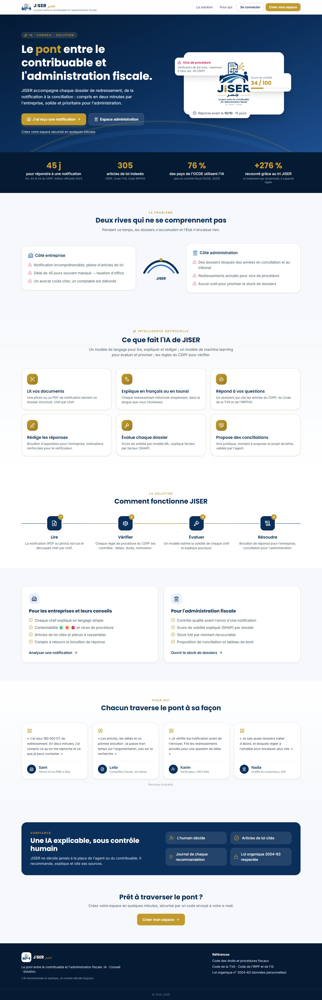 |  | 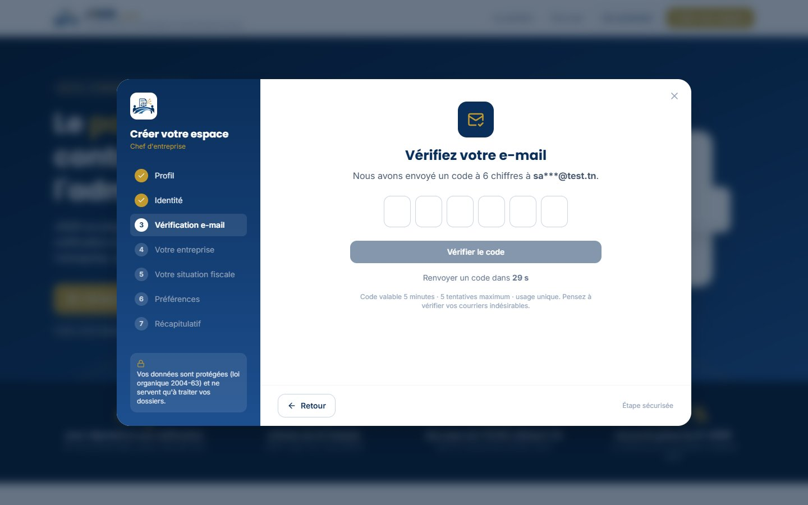 |

### Espace entreprise

| Tableau de bord | Analyser une notification |
|---|---|
|  |  |
| **Assistant fiscal IA** (sources citées, voix) | **Mes réponses** |
|  | 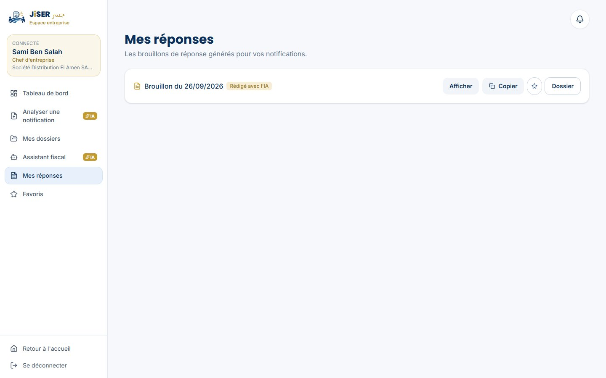 |

<details>
<summary><b>Voir l'analyse complète d'une notification</b> (français, puis tounsi avec brouillon de réponse)</summary>

| Analyse en français | Analyse en tounsi + brouillon |
|---|---|
| 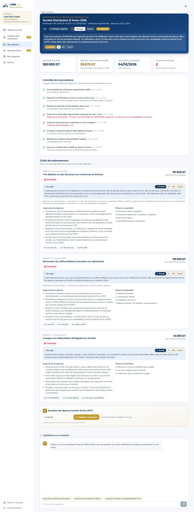 |  |

</details>

### Sur téléphone

| Accueil | Prendre une photo de la notification | Analyse |
|---|---|---|
| 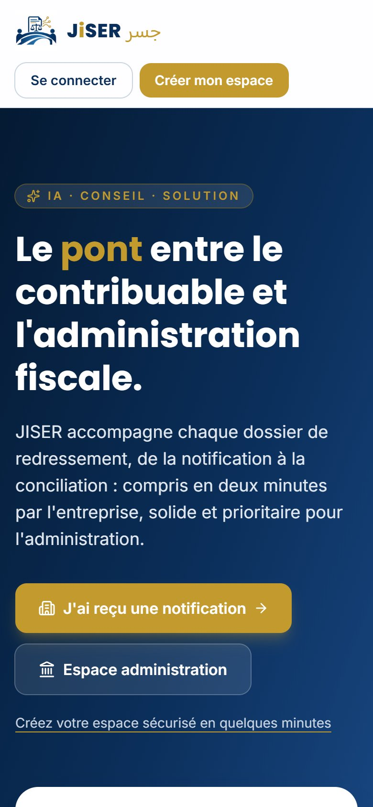 |  | 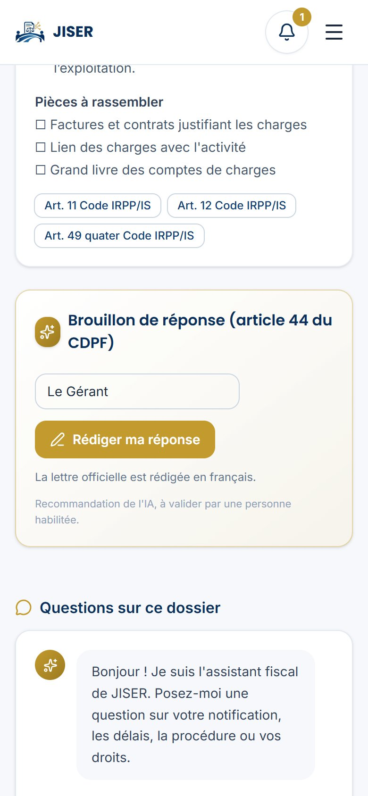 |

### Espace administration

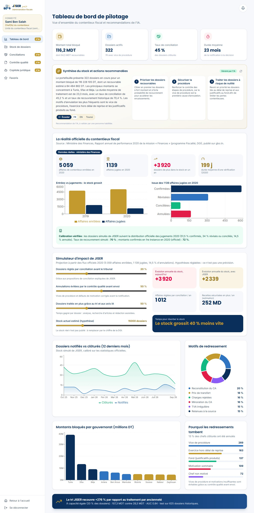

<p align="center"><i>Tableau de bord : synthèse IA du stock, chiffres officiels du ministère des Finances, simulateur d'impact, stock calibré.</i></p>

| Stock trié par priorité | Conciliations |
|---|---|
| 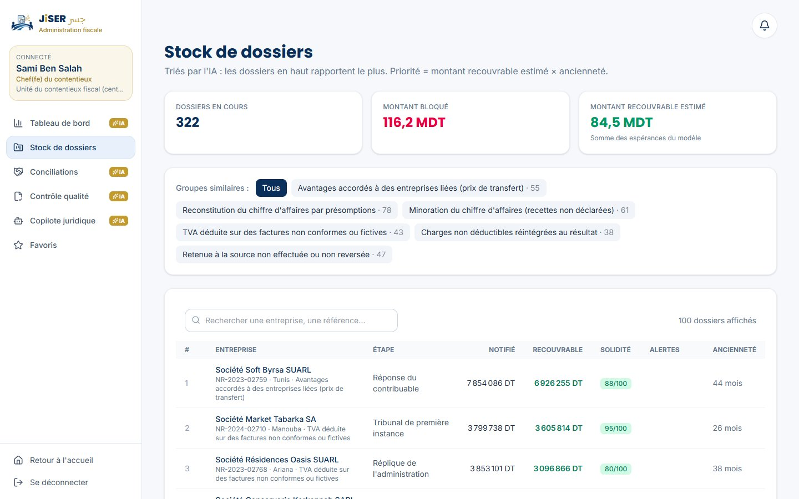 | 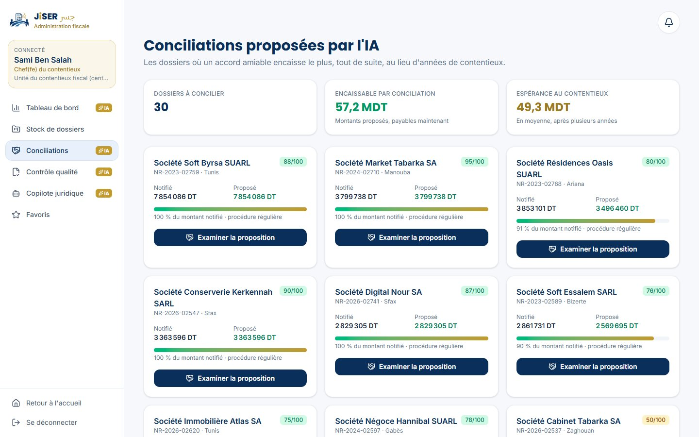 |
| **Copilote juridique** | **Contrôle qualité avant envoi** |
|  |  |

<details>
<summary><b>Voir un dossier : score SHAP, avis juridique IA et lettre de conciliation</b></summary>

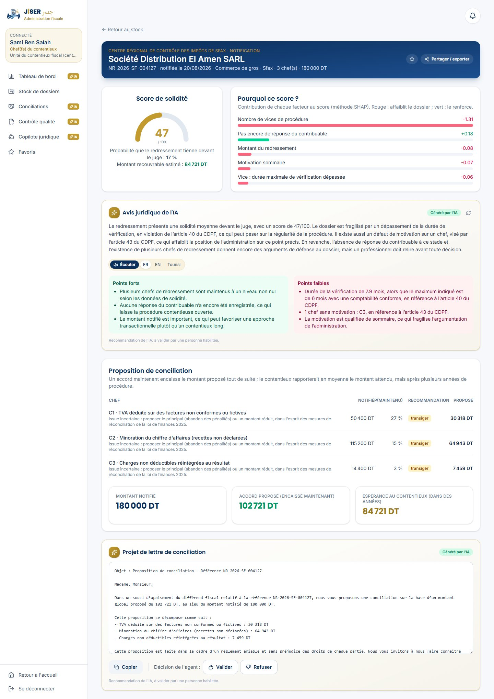

</details>

### Admin plateforme

| Pouls de la plateforme | Journal d'audit | Base juridique |
|---|---|---|
| 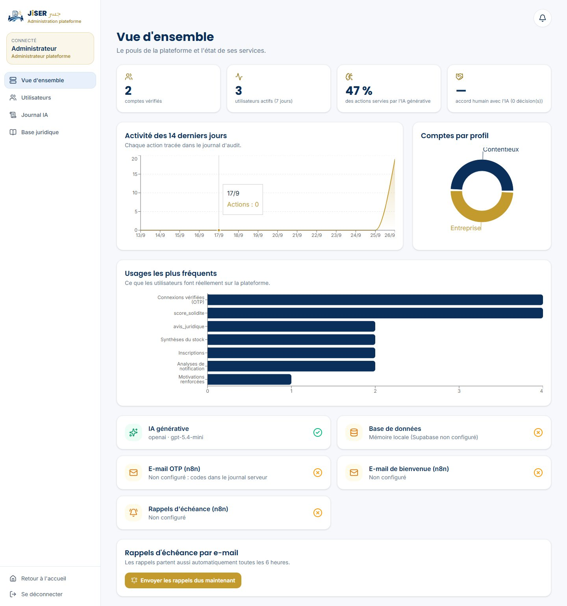 | 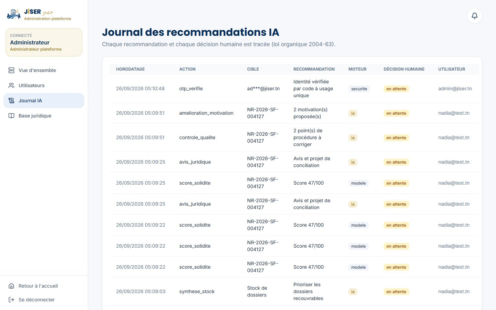 | 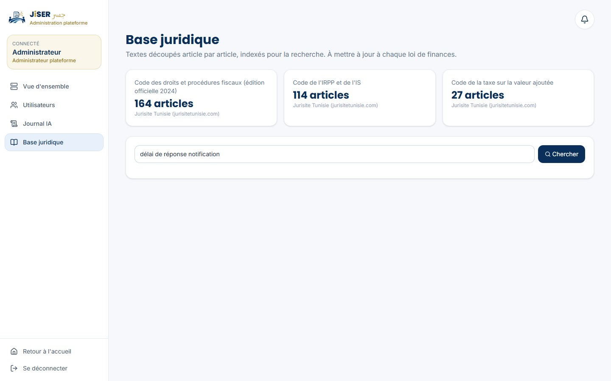 |

---

## Résultats

Mesurés sur 625 dossiers de test jamais vus par le modèle ([`models/metrics.json`](models/metrics.json)) :

| Indicateur | Résultat |
|---|---|
| AUC « chef maintenu devant le juge » | **0,84** |
| AUC « dossier recouvré à plus de 50 % » | **0,82** |
| Montant recouvré en traitant 20 % du stock : tri JISER vs ancienneté | **107,3 MDT vs 28,5 MDT (+276 %)** |
| Même comparaison vs « plus gros montants d'abord » | +2,4 % |
| Répartition des issues simulées vs jugements officiels 2020 | 51,9 / 33,6 / 14,5 % vs 51,5 / 33,9 / 14,5 % |

Ces chiffres valident la méthode sur des données simulées calibrées ; le modèle doit être réentraîné sur l'historique réel de la DGI.

---

## Architecture

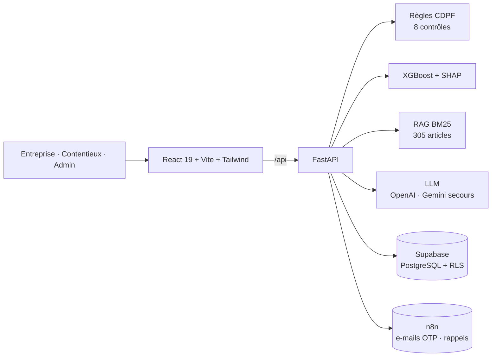

La documentation technique complète (modules, flux, IA, données, sécurité, API, mise en production) est dans **[docs/ARCHITECTURE.md](docs/ARCHITECTURE.md)**.

---

## Données

| Source | Utilisation |
|---|---|
| **CDPF, édition officielle 2024** (jibaya.tn) | Base juridique, règles de procédure, délai de 45 jours |
| Code de la TVA, Code de l'IRPP et de l'IS (Jurisite Tunisie) | Base juridique (RAG) |
| **Ministère des Finances, rapport annuel de performance 2020** (gbo.tn) | Chiffres officiels affichés, calibration de la simulation |
| Loi de finances 2026 | Recettes fiscales |
| 2 822 dossiers **synthétiques calibrés** | Entraînement du modèle, démonstration |

Les dossiers réels de contribuables sont couverts par le secret fiscal et la loi organique 2004-63 : **aucune donnée réelle de contribuable n'est utilisée**.

---

## Lancer le projet

Prérequis : Python 3.11+, Node.js 20+.

```bash
# 1. Backend
python -m venv .venv
.venv/Scripts/python -m pip install -r backend/requirements.txt    # Windows (Linux/Mac : .venv/bin/python)
cp .env.example .env                                                # puis remplir les clés
.venv/Scripts/python -m uvicorn app.main:app --app-dir backend --port 8000

# 2. Frontend (autre terminal)
cd frontend
npm install
npm run dev -- --host                                               # http://localhost:5173
```

- Documentation de l'API (Swagger) : http://localhost:8000/docs
- Espace administrateur : http://localhost:5173/plateforme (e-mails listés dans `ADMIN_EMAILS`)
- Sur téléphone : ouvrir l'adresse « Network » affichée par Vite (même réseau Wi-Fi)

| Service | Rôle | Variables |
|---|---|---|
| OpenAI | IA principale, lecture des photos, voix | `OPENAI_API_KEY`, `OPENAI_MODEL` |
| Google Gemini | IA de secours automatique | `GEMINI_API_KEY` |
| Supabase | Base de données (exécuter `supabase/schema.sql`, puis `scripts/seed_supabase.py`) | `SUPABASE_URL`, `SUPABASE_SERVICE_KEY` |
| n8n | E-mails : code, bienvenue, rappels (générer avec `scripts/build_n8n_workflows.py --cloud`) | `N8N_*_WEBHOOK_URL`, `N8N_SHARED_SECRET` |
| Admin | Accès à `/plateforme` | `ADMIN_EMAILS` |

Sans ces services, l'application reste utilisable : règles et modèle ML à la place de l'IA générative, base en mémoire, codes écrits dans le journal du serveur.

### Reproduire les données et le modèle

```bash
.venv/Scripts/python scripts/import_cdpf_officiel.py   # CDPF officiel 2024
.venv/Scripts/python scripts/scrape_legal.py           # Codes TVA et IRPP/IS
.venv/Scripts/python scripts/generate_synthetic.py     # dossiers calibrés + PDF de démo
.venv/Scripts/python scripts/train_model.py            # modèle + métriques
.venv/Scripts/python scripts/build_note.py             # note de synthèse (2 pages)
```

---

## Sécurité

- Connexion par **code à usage unique** envoyé par e-mail : 6 chiffres, 5 minutes, 5 essais, stocké haché.
- Sessions à jeton aléatoire de 256 bits, stocké haché, valable 8 heures.
- Contrôle des rôles sur chaque route de l'API.
- Espace administrateur invisible dans l'interface, réservé aux e-mails autorisés.
- Supabase avec Row Level Security, sans accès public ; clés uniquement côté serveur.
- Journal d'audit de chaque recommandation IA et de chaque décision humaine.

## Documents

| Document | Contenu |
|---|---|
| [docs/ARCHITECTURE.md](docs/ARCHITECTURE.md) | Architecture technique complète |
| [docs/JISER_note_de_synthese.pdf](docs/JISER_note_de_synthese.pdf) | Note de synthèse (2 pages) |
| [docs/JISER_PROMPT_COMPLET.md](docs/JISER_PROMPT_COMPLET.md) | Présentation détaillée du projet |

## Limites

- Modèle entraîné sur des données simulées calibrées : à réentraîner sur l'historique réel.
- Chiffres officiels détaillés les plus récents : 2020. Jurisprudence non intégrée.
- L'IA ne remplace ni l'avocat, ni le conseiller fiscal, ni l'agent : elle explique, recommande et cite ses sources.

---

<p align="center">
  <br>
  <sub>JISER · جسر · Le pont entre le contribuable et l'administration fiscale</sub>
</p>
