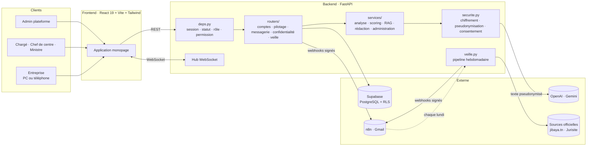
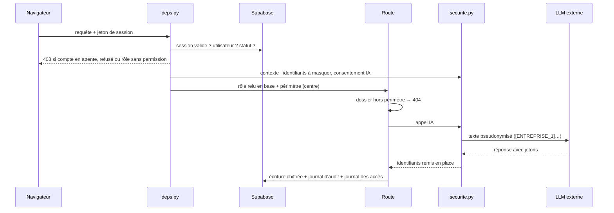
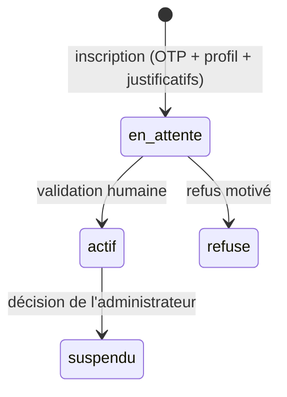
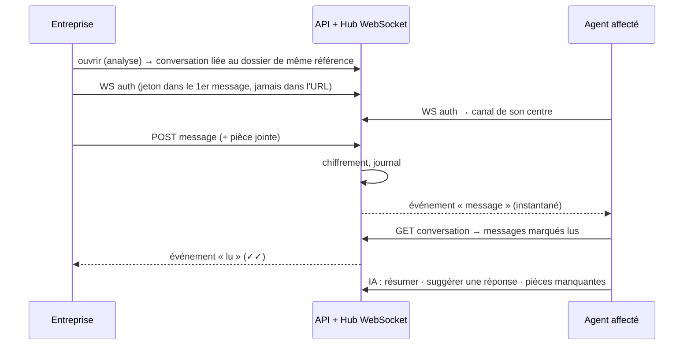
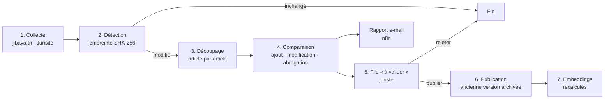

# JISER : architecture technique

Ce document décrit l'architecture complète de JISER : composants, flux, rôles et droits, IA, confidentialité, données, messagerie en temps réel, veille juridique, configuration, et ce qu'il faut pour la production.

Sommaire

1. [Vue d'ensemble](#1-vue-densemble)
2. [Architecture logique](#2-architecture-logique)
3. [Rôles, droits et périmètres](#3-rôles-droits-et-périmètres)
4. [Vérification des comptes](#4-vérification-des-comptes)
5. [Backend (FastAPI)](#5-backend-fastapi)
6. [Couche IA](#6-couche-ia)
7. [Confidentialité des données](#7-confidentialité-des-données)
8. [Messagerie en temps réel](#8-messagerie-en-temps-réel)
9. [Veille juridique automatisée](#9-veille-juridique-automatisée)
10. [Données](#10-données)
11. [Base de données (Supabase)](#11-base-de-données-supabase)
12. [Automatisations (n8n)](#12-automatisations-n8n)
13. [Frontend (React)](#13-frontend-react)
14. [API : référence des routes](#14-api--référence-des-routes)
15. [Configuration, lancement et tests](#15-configuration-lancement-et-tests)
16. [Ce qu'il faut pour la mise en production](#16-ce-quil-faut-pour-la-mise-en-production)
17. [Limites connues](#17-limites-connues)

---

## 1. Vue d'ensemble

JISER (جسر, « pont ») est une plateforme d'IA pour le **contentieux fiscal tunisien**, c'est-à-dire tout ce qui suit une notification de redressement.

| Espace | Utilisateur | Ce qu'il fait |
|---|---|---|
| **Entreprise** | Chef d'entreprise | Dépose sa notification (PDF, photo), la comprend chef par chef en français ou en arabe standard, contrôle la procédure, prépare sa réponse, échange en temps réel avec l'agent, contrôle ses données personnelles. |
| **Administration · ministre** | Ministre des Finances | Pilotage national en temps réel, filtres, statistiques anonymes, chiffres officiels, simulateur d'impact. |
| **Administration · chef de centre** | Chef d'un des 27 CRCI | Stock de son centre, affectation des dossiers, validation des conciliations importantes et des comptes de ses agents. |
| **Administration · chargé du contentieux** | Agent d'un CRCI | Dossiers de son centre, score SHAP, avis IA, contrôle qualité, copilote, messagerie avec les entreprises. |
| **Admin plateforme** | Lien privé | Validation des comptes, veille juridique, santé des services, journal d'audit. |

Principes : **l'IA recommande, l'humain décide** ; **chacun n'accède qu'à son espace** ; **aucune donnée identifiante ne part vers une IA externe**.

---

## 2. Architecture logique



**Parcours d'une requête protégée**



---

## 3. Rôles, droits et périmètres

Code : [`services/permissions.py`](../backend/app/services/permissions.py), [`deps.py`](../backend/app/deps.py).

La hiérarchie suit l'organisation du ministère des Finances : **Ministère → Direction générale des impôts → 27 centres régionaux de contrôle des impôts** (16 de catégorie A, 11 de catégorie B) **→ agents**.

| Rôle | Niveau | Périmètre | Permissions |
|---|---|---|---|
| `entreprise` | — | ses dossiers | `analyses:propres`, `messagerie:entreprise`, `donnees:propres`, `copilote`, `favoris` |
| `contentieux` | opérationnel | son centre | `stats:centre`, `dossiers:lire`, `dossier:avis`, `conciliation:proposer`, `controle_qualite`, `copilote`, `messagerie:administration` |
| `chef_centre` | régional | son centre | celles de l'agent + `dossiers:affecter`, `conciliation:valider`, `comptes:valider_agents`, `equipe:lire` |
| `ministre` | national | agrégats anonymes | `stats:national`, `copilote` |
| `admin` | plateforme | — | `plateforme`, `comptes:valider`, `veille:gerer`, `journal:lire` |

Mécanismes :
- **`compte`** (dépendance async) : la session doit être valide, l'utilisateur relu en base, son statut `actif`. Le **rôle vient toujours de la base**, jamais du navigateur. Elle fixe aussi le contexte de confidentialité de la requête.
- **`permission(p)`** : le rôle doit détenir `p`.
- **Périmètre** : un agent ou un chef de centre ne voit que les dossiers du gouvernorat de son centre (Tunis 1 à 3 et Sfax 1 et 2 partagent leur gouvernorat). Hors périmètre, l'API répond **404**, pour ne pas révéler l'existence du dossier.
- **Conciliation** : au-delà de `SEUIL_VALIDATION_CONCILIATION` (100 000 DT par défaut), la proposition d'un agent est soumise au chef de centre.
- **Affectation** : le chef de centre affecte un dossier à un agent de son centre ; un dossier affecté n'est plus accessible en messagerie aux autres agents.

---

## 4. Vérification des comptes

Code : [`services/comptes.py`](../backend/app/services/comptes.py), [`routers/comptes.py`](../backend/app/routers/comptes.py).



1. **Inscription** : e-mail vérifié par OTP, profil (entreprise, ou administration puis choix du rôle), **justificatifs** (extrait RNE et CIN pour une entreprise ; carte professionnelle, décision ou décret de nomination pour l'administration).
2. **Pré-vérification automatique** (score affiché au validateur) :

| Profil | Contrôles |
|---|---|
| Entreprise | pièces présentes, format du matricule fiscal, matricule non déjà utilisé, **raison sociale et matricule retrouvés dans l'extrait RNE** (lecture locale du PDF), adresse professionnelle |
| Administration | pièces présentes, **adresse e-mail officielle** (`OFFICIAL_EMAIL_DOMAINS`), centre de rattachement, matricule d'agent, un seul ministre actif |

3. **Validation humaine sous 24 h** :
   - chargé du contentieux → par **le chef de son centre** (hiérarchie), ou l'administrateur ;
   - entreprise, chef de centre, ministre → par l'administrateur plateforme.
4. **Notification** : e-mails « demande reçue », « compte activé » ou « demande refusée (motif) » via n8n. Chaque décision est inscrite au journal.

Tant que le compte n'est pas `actif`, l'utilisateur ne voit que sa page de suivi, qui se met à jour seule.

---

## 5. Backend (FastAPI)

Code : [`backend/app/`](../backend/app/)

| Fichier | Rôle |
|---|---|
| `main.py` | Routes historiques (analyse, dossiers, tableau de bord, plateforme), inclusion des routeurs, démarrage des planificateurs |
| `deps.py` | Contrôle d'accès (session, statut, rôle, permission), secret n8n, journal des accès |
| `config.py` | Lecture du `.env` |
| `domain.py` | Types de chefs, règles de procédure, délais (45 j, 10 j, 90 j), gouvernorats |
| `routers/comptes.py` | Justificatifs, soumission, file de validation, décision |
| `routers/pilotage.py` | Tableau national, équipe, affectations, conciliations à valider |
| `routers/messagerie.py` | Conversations, messages, pièces, IA, **WebSocket** |
| `routers/confidentialite.py` | Accès, export, effacement, consentements, aperçu IA, registre |
| `routers/veille.py` | État du pipeline, lancement, validation des changements, embeddings |

### Services

| Service | Ce qu'il fait |
|---|---|
| `extraction.py` | PDF, photo ou texte → notification structurée |
| `procedure.py` | 8 contrôles du CDPF (art. 19-20, 39, 40, 43-44) |
| `features.py`, `scoring.py` | 26 variables par chef ; XGBoost 3 classes + SHAP |
| `legal_rag.py` | **Recherche hybride** : BM25 + similarité vectorielle, fusion par rang réciproque |
| `analysis.py`, `drafting.py`, `letter.py` | Analyse côté entreprise, brouillon de réponse (art. 44) |
| `assistant.py` | Assistant et copilote, réponses en streaming |
| `administration.py` | Tri du stock, conciliation, tableau de bord (national ou par centre) |
| `ai_admin.py` | Synthèse du stock, avis juridique, amélioration des motivations |
| `pilotage.py` | Agrégats nationaux filtrés et k-anonymes, activité 24 h, équipe, affectations, validations |
| `comptes.py` | Pré-vérification, file de validation, décision, notifications |
| `messagerie.py` | Conversations par notification, règles d'accès, IA dans l'échange, hub WebSocket |
| `securite.py` | Chiffrement, pseudonymisation, consentement, neutralisation pour la voix |
| `veille.py` | Pipeline de veille juridique, versions, embeddings, planificateur |
| `permissions.py` | Rôles, permissions, 27 CRCI, périmètres |
| `db.py` | Supabase ou mémoire (même interface), **chiffrement à l'écriture** |
| `voix.py`, `export_pdf.py`, `rappels.py`, `auth.py`, `llm.py` | Voix, PDF, rappels J-15 à J-1, OTP et sessions, passerelle LLM |

---

## 6. Couche IA

| Type | Utilisé pour | Pourquoi |
|---|---|---|
| **Règles déterministes** | Contrôle de procédure, délais, calculs | Le droit est exact |
| **Machine learning** (XGBoost + SHAP) | Probabilité qu'un chef tienne devant le juge, tri du stock, conciliation | Prédiction mesurable et explicable |
| **IA générative** (LLM + RAG) | Lecture des photos, explications en français ou en arabe standard, assistant, rédaction, avis, aide à la messagerie | Langage naturel ancré dans les articles |

- **Passerelle LLM** : OpenAI `gpt-5.4-mini` en principal, Gemini Flash en secours automatique, Claude en option ; sorties structurées ; disjoncteur ; cache disque (pseudonymisé) ; mode hors ligne.
- **RAG hybride** : 305 articles ; BM25 (mots exacts) + embeddings `text-embedding-3-small` (sens), fusionnés. Exemple mesuré : la question « ما هو أجل الرد على الإعلام بنتائج المراجعة؟ » → **article 44 du CDPF** en premier ; BM25 seul ne trouve **aucun** article, car les codes sont en français.
- **Langues** : français et **arabe standard moderne** (الفصحى), avec la terminologie fiscale officielle tunisienne (« الفصل 44 من مجلة الحقوق والإجراءات الجبائية », « التوظيف الإجباري »). Affichage de droite à gauche automatique ; voix arabe. Le brouillon de réponse officiel reste en français.
- **Anti-hallucination** : numéros d'articles injectés dans les faits ; le modèle ne cite que ceux-là.

| Mesure (625 dossiers de test) | Valeur |
|---|---|
| AUC « chef maintenu » | **0,84** |
| AUC « dossier recouvré ≥ 50 % » | **0,82** |
| Tri JISER vs ancienneté (capacité 20 %) | **+276 %** |

---

## 7. Confidentialité des données

Détails et correspondance avec la loi 2004-63 : **[CONFIDENTIALITE.md](CONFIDENTIALITE.md)**.

| Mécanisme | Où | Effet |
|---|---|---|
| Chiffrement au repos (Fernet) | `db.py`, `securite.py` | Analyses, réponses, messages, pièces, justificatifs illisibles en base |
| Pseudonymisation | `llm.py` → `securite.masquer` | Aucun nom, matricule, e-mail, téléphone, RIB, CIN envoyé à l'IA ; jetons restaurés côté serveur, y compris en streaming |
| Consentement IA | `deps.compte` → contexte | Consentement retiré : l'IA générative est coupée pour cet utilisateur, règles et ML seulement |
| k-anonymat | `pilotage.national` | Groupes < 5 dossiers masqués pour le ministre |
| Journal des accès | `deps.journaliser_acces` | L'entreprise voit chaque consultation de ses dossiers (rôle, centre, date) |
| Export, effacement | `routers/confidentialite.py` | Droit d'accès (JSON) et droit à l'effacement |
| E-mails sans contenu | `messagerie.envoyer` | Une alerte de message ne contient jamais le texte |

---

## 8. Messagerie en temps réel



- **Canaux** : `conv:<id>`, `zone:<gouvernorat>` (boîte de réception du centre), `user:<id>`.
- **Accès** : l'entreprise ; l'agent affecté (ou tout agent du centre si non affecté) ; le chef de centre. Ni le ministre ni l'administrateur plateforme.
- **Indicateurs** : « en train d'écrire », accusés de lecture, compteur de non-lus.
- **Hors ligne** : si l'entreprise n'est pas connectée, un e-mail l'avertit, sans le contenu.

---

## 9. Veille juridique automatisée

Code : [`services/veille.py`](../backend/app/services/veille.py). Déclenchement : planificateur interne hebdomadaire, workflow n8n (lundi 6 h, `POST /api/n8n/veille`), ou bouton dans l'espace administrateur.



- **Rien n'atteint l'IA sans validation humaine.**
- **Versions** : `data/legal/versions/<code>.json` garde chaque texte remplacé, avec ses dates de validité.
- **Simulation** : un changement fictif, clairement marqué, démontre le circuit ; le valider ne modifie jamais la base.
- **Première exécution réelle** : CDPF identique (154 articles), Code IRPP/IS identique (114), **Code de la TVA : 7 articles différents** de la base, placés en attente de validation.

---

## 10. Données

| Jeu | Emplacement | Source |
|---|---|---|
| CDPF, édition officielle 2024 (154 articles + 10 complétés) | `data/legal/cdpf.json` | PDF officiel (jibaya.tn) |
| Code de la TVA (27), Code de l'IRPP et de l'IS (114) | `data/legal/ctva.json`, `cirppis.json` | Jurisite Tunisie |
| Embeddings des 305 articles | `data/legal/embeddings.npz` | OpenAI `text-embedding-3-small` |
| État de la veille, versions | `data/legal/veille/`, `data/legal/versions/` | Pipeline de veille |
| Indicateurs officiels | `data/real/indicateurs_officiels.json` | Ministère des Finances, RAP 2020 ; LF 2026 |
| 2 822 dossiers | `data/synthetic/dossiers.json` | Synthétiques, **calibrés sur les jugements officiels 2020** |

Aucune donnée réelle de contribuable (secret fiscal, loi 2004-63).

---

## 11. Base de données (Supabase)

Schéma : [`supabase/schema.sql`](../supabase/schema.sql) puis [`supabase/migration_002_roles_messagerie_confidentialite.sql`](../supabase/migration_002_roles_messagerie_confidentialite.sql).

| Table | Contenu |
|---|---|
| `utilisateurs` | Profil, rôle, **statut** (`en_attente`, `actif`, `refuse`, `suspendu`), **vérification** (pré-contrôles, décision, motif), consentements |
| `otp_codes`, `sessions` | Codes et jetons, stockés hachés |
| `analyses`, `reponses` | Analyses et brouillons (**chiffrés**) |
| `pieces_justificatives` | Justificatifs d'identité (**chiffrés**) |
| `affectations` | Dossier → agent, par le chef de centre |
| `conciliations` | Propositions soumises au chef de centre, décision |
| `conversations`, `messages` | Messagerie (contenus et pièces **chiffrés**), accusés de lecture |
| `acces` | Journal des consultations (rôle, centre, action) montré à l'entreprise |
| `journal` | Audit de chaque recommandation IA et décision humaine |
| `dossiers`, `favoris` | Stock de l'administration, favoris |

Row Level Security activée partout, **aucune politique publique** : seule l'API (clé de service, côté serveur) lit et écrit. Les suppressions de compte se propagent en cascade.

---

## 12. Automatisations (n8n)

| Workflow | Déclencheur | Rôle |
|---|---|---|
| `jiser-otp` | API | Code de connexion |
| `jiser-bienvenue` | API (compte validé) | Bienvenue et étapes selon le rôle |
| `jiser-rappel` | API | Échéance enregistrée, rappels J-15, J-7, J-3, J-1 |
| `jiser-notification` | API | Demande reçue, compte validé ou refusé, nouveau message (sans contenu), rapport de veille |
| `jiser-veille` | Chaque lundi 6 h | Lance le pipeline de veille (`POST /api/n8n/veille`, secret requis) |

Chaque webhook vérifie `X-Jiser-Secret`. Générés par [`scripts/build_n8n_workflows.py`](../scripts/build_n8n_workflows.py).

---

## 13. Frontend (React)

| Dossier / fichier | Contenu |
|---|---|
| `api.ts` | Types et clients : `api`, `authApi`, `comptesApi`, `pilotageApi`, `messagerieApi`, `confidentialiteApi`, `veilleApi` |
| `App.tsx` | Routes ; un compte non actif n'atteint que `/compte` |
| `components/Onboarding.tsx` | Profil → **rôle administration** → identité → OTP → métier → **justificatifs** → consentements → « demande envoyée » |
| `components/CompteEnAttente.tsx` | Suivi de la vérification, rafraîchi toutes les 20 s |
| `components/Messagerie.tsx` | Messagerie partagée, hook `useTempsReel` (WebSocket, reconnexion) |
| `components/DemandesAcces.tsx` | File de validation (admin et chef de centre) |
| `pages/Administration.tsx` | Menu et routes **selon le rôle** |
| `pages/administration/Pilotage.tsx` | Ministre : temps réel (10 s), filtres, k-anonymat, chiffres officiels, simulateur |
| `pages/administration/Equipe.tsx` | Chef de centre : conciliations à valider, équipe, affectations, comptes d'agents |
| `pages/entreprise/Confidentialite.tsx` | Aperçu de ce que voit l'IA, accès, consentements, export, effacement, registre |
| `pages/plateforme/Veille.tsx` | Pipeline, sources, changements (différences mot à mot), historique, embeddings |

---

## 14. API : référence des routes

Documentation interactive : `http://localhost:8000/docs`.

| Groupe | Routes |
|---|---|
| Public | `GET /api/status` · `/api/public/chiffres` · `/api/public/referentiel` · `/api/donnees-officielles` |
| Authentification | `POST /api/auth/otp/demander` · `/otp/verifier` · `/profil` · `/deconnexion` · `GET /api/auth/moi` |
| Comptes | `POST /api/comptes/pieces` · `/soumettre` · `GET /statut` · `/demandes` · `/pieces/{id}` · `POST /demandes/{id}/decision` |
| Entreprise | `/api/contribuable/analyser` · `/analyses` · `/analyses/{id}` (+ `/pdf`) · `/brouillon` · `/reponses` · `/assistant` (+ `/stream`) |
| Messagerie | `GET/POST /api/messagerie/conversations` · `GET /conversations/{id}` · `POST /conversations/{id}/messages` · `/conversations/{id}/ia` · `GET /messages/{id}/piece` · `/dossier/{id}` · **WS `/api/messagerie/ws`** |
| Confidentialité | `GET /api/confidentialite/acces` · `/export` · `/apercu-ia` · `/registre` · `PUT /consentements` · `POST /suppression` |
| Administration | `/api/admin/dossiers` (+ `mes=true`) · `/dossiers/{id}` (+ `/avis-ia`, `/pdf`, `/decision`) · `/controle-qualite` · `/ameliorer-notification` · `/tableau-de-bord` · `/synthese-ia` · `/conciliations` |
| Pilotage | `GET /api/pilotage/national` · `/equipe` · `/conciliations-a-valider` · `POST /affectations` · `/conciliations/{id}/decision` |
| Plateforme | `/api/plateforme/utilisateurs` · `/journal` · `/base-juridique` · `/recherche-juridique` · `/systeme` · `/rappels` · `/veille` (+ `/lancer`, `/simuler`, `/changements/{id}/decision`, `/embeddings`, `/historique/{id}`) |
| n8n | `GET /api/n8n/echeances` · `POST /api/n8n/veille` (secret requis) |

---

## 15. Configuration, lancement et tests

| Variable | Rôle |
|---|---|
| `OPENAI_API_KEY`, `OPENAI_MODEL`, `GEMINI_API_KEY`, `ANTHROPIC_API_KEY`, `JISER_LLM_PROVIDER` | IA, embeddings, voix |
| `SUPABASE_URL`, `SUPABASE_SERVICE_KEY` | Base de données |
| `N8N_OTP_WEBHOOK_URL`, `N8N_WELCOME_WEBHOOK_URL`, `N8N_RAPPEL_WEBHOOK_URL`, `N8N_NOTIF_WEBHOOK_URL`, `N8N_SHARED_SECRET` | E-mails et secret partagé |
| `JISER_DATA_KEY` | Clé de chiffrement (sinon dérivée de la clé Supabase) |
| `ADMIN_EMAILS`, `OFFICIAL_EMAIL_DOMAINS`, `SEUIL_VALIDATION_CONCILIATION`, `APP_URL` | Accès et règles de gestion |

```bash
.venv/Scripts/python -m uvicorn app.main:app --app-dir backend --port 8000   # API
cd frontend && npm run dev -- --host                                         # interface
.venv/Scripts/python -m pytest tests -q                                      # tests de sécurité
```

**Tests** ([tests/test_securite_acces.py](../tests/test_securite_acces.py), base en mémoire, sans e-mail ni IA externe) :
- isolation des espaces ;
- périmètre du centre ;
- validation hiérarchique des comptes ;
- affectation et validation des conciliations ;
- messagerie, avec son chiffrement ;
- pseudonymisation ;
- retrait du consentement ;
- simulation de veille sans effet sur la base ;
- droit à l'effacement.

Reproduire les données : `import_cdpf_officiel.py`, `scrape_legal.py`, `generate_synthetic.py`, `train_model.py`, `seed_supabase.py`, `build_note.py`, `build_n8n_workflows.py`.

---

## 16. Ce qu'il faut pour la mise en production

| Besoin | Solution proposée |
|---|---|
| Historique réel des dossiers (DGI) | Convention, anonymisation, réentraînement du modèle |
| Vérification d'identité automatique | Connexion au registre national des entreprises (RNE) et à l'annuaire de l'administration |
| Hébergement souverain | Cloud national ou serveurs du ministère |
| LLM hébergé localement | Modèle ouvert servi en interne (la passerelle est déjà multi-fournisseurs) |
| Clés | Coffre-fort de secrets, rotation de `JISER_DATA_KEY` |
| Domaine, HTTPS, e-mails | Domaine officiel (SPF, DKIM, DMARC), TLS, reverse proxy ; API publique pour les workflows n8n |
| Veille élargie | Notes communes de la DGI, JORT, lois de finances ; pgvector pour les embeddings |
| Conformité | Déclaration INPDP, analyse d'impact, purge selon le registre des traitements |
| Temps réel à l'échelle | Hub WebSocket partagé (Redis pub/sub) pour plusieurs serveurs |

---

## 17. Limites connues

- Modèle entraîné sur des données simulées calibrées ; chiffres officiels détaillés les plus récents : 2020.
- La vérification des justificatifs est locale (PDF) ; les images sont contrôlées visuellement par le validateur.
- Le hub WebSocket vit dans un seul processus (suffisant pour un centre ; Redis au-delà).
- Jurisprudence non intégrée.
- L'IA ne remplace ni l'avocat, ni le conseiller fiscal, ni l'agent.
