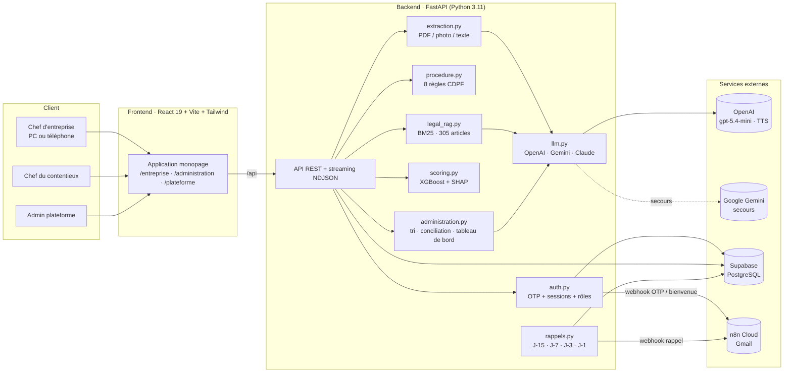
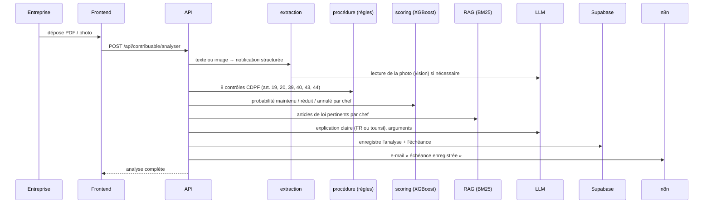
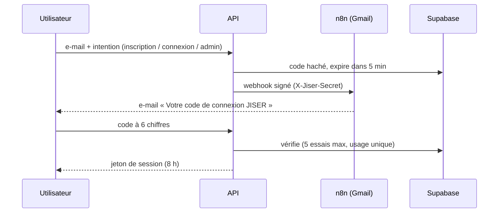

# JISER : architecture technique

Ce document décrit l'architecture complète de JISER : les composants, les flux de données, l'IA, la sécurité, la configuration et tout ce qu'il faut pour faire tourner la plateforme ou la mettre en production.

Sommaire

1. [Vue d'ensemble](#1-vue-densemble)
2. [Architecture logique](#2-architecture-logique)
3. [Backend (FastAPI)](#3-backend-fastapi)
4. [Couche IA](#4-couche-ia)
5. [Données](#5-données)
6. [Base de données (Supabase)](#6-base-de-données-supabase)
7. [Authentification et sécurité](#7-authentification-et-sécurité)
8. [Automatisations e-mail (n8n)](#8-automatisations-e-mail-n8n)
9. [Frontend (React)](#9-frontend-react)
10. [API : référence des routes](#10-api--référence-des-routes)
11. [Configuration et lancement](#11-configuration-et-lancement)
12. [Reproduire les données et le modèle](#12-reproduire-les-données-et-le-modèle)
13. [Ce qu'il faut pour la mise en production](#13-ce-quil-faut-pour-la-mise-en-production)
14. [Limites connues](#14-limites-connues)

---

## 1. Vue d'ensemble

JISER (جسر, « pont ») est une plateforme d'IA pour le **contentieux fiscal tunisien**, c'est-à-dire tout ce qui suit une notification de redressement après une vérification fiscale.

| Espace | Utilisateur | Ce qu'il fait |
|---|---|---|
| **Entreprise** | Chef d'entreprise | Dépose sa notification (PDF, photo, texte). JISER l'explique chef par chef en français ou en tounsi, contrôle la procédure du CDPF, estime ce qui est contestable, calcule la date limite (45 jours), rédige un brouillon de réponse et envoie des rappels. |
| **Administration** | Chef(fe) du contentieux | Voit le stock trié par montant recouvrable, le score de solidité de chaque dossier expliqué (SHAP), l'avis juridique de l'IA, une proposition de conciliation, un contrôle qualité avant envoi, un copilote juridique, les chiffres officiels et un simulateur d'impact. |
| **Admin plateforme** | Administrateur (lien privé) | Santé des services, activité, utilisateurs, journal d'audit de chaque recommandation IA, base juridique. |

Principe directeur : **l'IA recommande et explique, la décision reste humaine**. Chaque recommandation et chaque décision est tracée.

---

## 2. Architecture logique



**Chemin d'une analyse de notification (côté entreprise)**



---

## 3. Backend (FastAPI)

Code : [`backend/app/`](../backend/app/)

| Fichier | Rôle |
|---|---|
| `main.py` | Toutes les routes, contrôle d'accès par rôle (`require(*roles)`), démarrage (test du LLM, planificateur de rappels). |
| `config.py` | Lecture du `.env`, chemins des données, choix automatique du fournisseur d'IA. |
| `domain.py` | Connaissance métier : 6 types de chefs de redressement (articles, pièces, taux de maintien de base), règles de procédure, délais (45 j, 10 j, 90 j), gouvernorats, étapes. |
| `schemas.py` | Modèles Pydantic : Entreprise, ChefRedressement, Notification, Dossier, AnalyseNotification, ScoreDossier… |

### Services ([`backend/app/services/`](../backend/app/services/))

| Service | Ce qu'il fait |
|---|---|
| `extraction.py` | Transforme un PDF (pypdf), une photo (vision LLM) ou un texte en notification structurée (entreprise, dates, chefs, montants). Un parseur à règles sert de base et de secours. |
| `procedure.py` | 8 règles déterministes du CDPF : avis préalable (art. 39), délai de 15 jours, droit à l'assistance, durée maximale de vérification (art. 40), motivation des chefs (art. 43), délai de réponse de 45 jours (art. 43-44), montants chiffrés, délai de reprise de 4 ans (art. 19-20). |
| `features.py` | 26 variables par chef (type, montant, exercice, vices, motivation, secteur…). |
| `scoring.py` | Modèle XGBoost 3 classes (maintenu / réduit / annulé) par chef, agrégé par dossier en score de solidité 0-100 et montant recouvrable ; explications SHAP. |
| `legal_rag.py` | Recherche BM25 (rank-bm25) sur 305 articles (CDPF officiel 2024, Code de la TVA, Code de l'IRPP et de l'IS), avec expansion des termes en tounsi. |
| `analysis.py` | Assemble l'analyse côté entreprise : contrôle de procédure, contestabilité par chef, arguments, pièces à réunir, date limite, explications (FR / tounsi). |
| `drafting.py` + `letter.py` | Brouillon de la lettre d'opposition (art. 44) ; gabarit complet hors ligne, reformulé par le LLM sans ajouter de faits. |
| `assistant.py` | Assistant fiscal et copilote juridique : RAG + LLM, réponses en streaming mot à mot, articles cités, suggestions de questions. |
| `administration.py` | Tri du stock (priorité = montant recouvrable attendu × (1 + 0,25 × min(ancienneté en années, 2))), conciliation par chef, tableau de bord (séries mensuelles, motifs, gouvernorats). |
| `ai_admin.py` | Synthèse IA du stock, avis juridique par dossier (points forts / faibles, lettre de conciliation), amélioration des motivations avant envoi. |
| `voix.py` | Lecture à voix haute (OpenAI `gpt-4o-mini-tts`, voix « coral ») en français, anglais ou tounsi (texte réécrit en écriture arabe pour la prononciation). |
| `export_pdf.py` | Export PDF (ReportLab) du rapport d'analyse et de la fiche dossier. |
| `rappels.py` | Rappels d'échéance à J-15, J-7, J-3, J-1 ; vérification toutes les 6 h ; dédoublonnage par le journal. |
| `auth.py` | Codes OTP, sessions, rôles, envoi des e-mails via n8n. |
| `db.py` | Dépôt de données : `SupabaseRepo` en production, `MemoryRepo` en secours (même interface). |
| `store.py` | Dossiers de l'administration chargés en mémoire, journalisation des recommandations. |
| `llm.py` | Passerelle multi-fournisseurs (voir section 4). |

### Règles de conciliation

| Part du montant qui tiendrait devant le juge | Vice de procédure | Recommandation |
|---|---|---|
| ≥ 70 % | non | **Maintenir** |
| 30 % à 70 % | — | **Transiger** (principal, abandon des pénalités ou montant réduit) |
| < 30 % | — | **Abandonner** |

---

## 4. Couche IA

JISER combine **trois types d'IA**, chacun là où il est le plus fiable :

| Type | Utilisé pour | Pourquoi |
|---|---|---|
| **Règles déterministes** | Contrôle de procédure, délais, calculs | Le droit est exact : pas de place pour l'approximation. |
| **Machine learning** (XGBoost + SHAP) | Probabilité qu'un chef tienne devant le juge, tri du stock | Prédiction chiffrée, mesurable, explicable facteur par facteur. |
| **IA générative** (LLM + RAG) | Lecture des photos, explications en langage clair et en tounsi, assistant, rédaction, avis juridique | Langage naturel, toujours ancré dans les articles retrouvés par le RAG. |

### Passerelle LLM (`llm.py`)

- **Fournisseur principal** : OpenAI `gpt-5.4-mini`, sorties structurées (Pydantic), `reasoning_effort=low`.
- **Secours automatique** : Google Gemini Flash (modèle le plus récent détecté, puis `gemini-3.5-flash`, `gemini-flash-latest`, `gemini-2.5-flash`), avec une nouvelle tentative après 2 s.
- **Option** : Claude (Anthropic).
- **Disjoncteur** par fournisseur : un fournisseur en erreur est écarté, sans bloquer l'application.
- **Cache disque** (`data/cache/`) : une même question ne coûte qu'un appel.
- **Mode hors ligne** : sans clé, tout fonctionne avec les règles, le modèle ML et des gabarits.
- **Contrôle du tounsi** : les réponses en tounsi doivent être en lettres latines (arabizi) ; sinon réécriture automatique, puis translittération de secours.
- **Anti-hallucination** : les numéros d'articles exacts sont injectés dans les faits ; le modèle a l'ordre de ne citer que ceux-là.

### Modèle de prédiction

- XGBoost, 3 classes par chef, 26 variables, 300 arbres de profondeur 4.
- Découpage par dossier (GroupShuffleSplit), pour éviter toute fuite entre les chefs d'un même dossier.
- Résultats sur 625 dossiers de test (1 459 chefs), voir [`models/metrics.json`](../models/metrics.json) :

| Mesure | Valeur |
|---|---|
| AUC « chef maintenu » | **0,84** |
| AUC « dossier recouvré à 50 % ou plus » | **0,82** |
| Exactitude 3 classes | 0,675 |
| Erreur moyenne sur le taux de recouvrement | 0,171 |
| Tri JISER vs ancienneté (capacité 20 %) | **+276 %** (107,3 MDT contre 28,5 MDT) |
| Tri JISER vs plus gros montants | +2,4 % |

---

## 5. Données

| Jeu | Emplacement | Source |
|---|---|---|
| **CDPF, édition officielle 2024** (154 articles) | `data/legal/cdpf.json` | PDF officiel (jibaya.tn), importé par `scripts/import_cdpf_officiel.py` ; 10 articles complétés depuis Jurisite, marqués « à vérifier ». |
| Code de la TVA (27 articles), Code de l'IRPP et de l'IS (114 articles) | `data/legal/ctva.json`, `data/legal/cirppis.json` | Jurisite Tunisie (`scripts/scrape_legal.py`). |
| **Indicateurs officiels** | `data/real/indicateurs_officiels.json` | Ministère des Finances, Rapport annuel de performance 2020, mission « Finances » (gbo.tn) ; loi de finances 2026 pour les recettes fiscales. |
| Dossiers de contentieux (2 822) | `data/synthetic/dossiers.json` | Générés par `scripts/generate_synthetic.py`, **calibrés sur les chiffres officiels**. |
| PDF de démonstration | `data/synthetic/samples/` | Notifications fictives (Sfax, Monastir). |

**Pourquoi des dossiers synthétiques ?** Les dossiers réels de contribuables sont couverts par le secret fiscal et la loi organique 2004-63 sur les données personnelles ; ils ne sont pas publics. JISER utilise donc :

1. les **vrais chiffres agrégés** publiés par le ministère des Finances, affichés tels quels dans le tableau de bord ;
2. des dossiers simulés **calibrés** pour reproduire la distribution officielle des jugements de 2020 : 51,5 % confirmés, 33,9 % révisés ou conciliés, 14,5 % annulés (simulation : 51,9 / 33,6 / 14,5 %). Taux de recouvrement simulé : 70 %, contre 71,8 % de montants confirmés en première instance (officiel 2020).

Chiffres officiels clés (RAP 2020) : 5 059 affaires enrôlées en 2020 contre 1 139 jugées, soit **près de 3 900 dossiers de plus dans le stock chaque année** ; durée moyenne d'une vérification : 199 jours.

---

## 6. Base de données (Supabase)

Schéma : [`supabase/schema.sql`](../supabase/schema.sql). PostgreSQL géré par Supabase.

| Table | Contenu |
|---|---|
| `utilisateurs` | Profil, rôle, détails (raison sociale, matricule fiscal…), consentements, dates. |
| `otp_codes` | Code haché (SHA-256 salé), expiration, essais, dernier envoi. |
| `sessions` | Jeton haché, rôle, expiration. |
| `analyses` | Analyses de notifications de chaque entreprise, date limite de réponse. |
| `reponses` | Brouillons de réponse générés. |
| `journal` | Journal d'audit : action, cible, recommandation, mode (IA / modèle / humain), décision humaine, utilisateur. |
| `dossiers` | Stock de dossiers de l'administration. |
| `favoris` | Articles, réponses et dossiers mis en favori. |

- **Row Level Security activée sans aucune politique publique** : seule l'API, avec la clé de service côté serveur, lit et écrit.
- Sans Supabase, `MemoryRepo` prend le relais (données perdues au redémarrage).

---

## 7. Authentification et sécurité



| Mesure | Détail |
|---|---|
| Code à usage unique | 6 chiffres, valable 5 minutes, 5 essais, un renvoi toutes les 30 secondes ; seul un hachage salé est stocké. |
| Session | Jeton aléatoire de 256 bits, stocké haché, valable 8 heures, effacé à la fermeture de l'onglet. |
| Rôles | Chaque route vérifie le rôle : `entreprise`, `contentieux`, `admin`. |
| Admin | Aucun lien dans l'interface ; accès par `/plateforme` uniquement pour les e-mails de `ADMIN_EMAILS`. |
| n8n | Chaque webhook exige le secret partagé `N8N_SHARED_SECRET` (en-tête `X-Jiser-Secret`). |
| Secrets | Uniquement dans `.env` (ignoré par git) ; aucune clé côté navigateur. |
| Données | Aucune donnée réelle de contribuable ; consentement explicite (loi 2004-63) à l'inscription. |
| Traçabilité | Chaque recommandation IA et chaque décision humaine est inscrite au journal. |

---

## 8. Automatisations e-mail (n8n)

Workflows générés par [`scripts/build_n8n_workflows.py`](../scripts/build_n8n_workflows.py) (`--cloud` pour n8n Cloud avec le nœud Gmail).

| Workflow | Webhook | Déclencheur | E-mail |
|---|---|---|---|
| Code OTP | `jiser-otp` | Demande de code | « Votre code de connexion JISER » |
| Bienvenue | `jiser-bienvenue` | Compte activé | Étapes suivantes selon le profil |
| Rappel d'échéance | `jiser-rappel` | Analyse enregistrée, puis J-15, J-7, J-3, J-1 | Date limite et lien vers la réponse |

Chaque workflow : Webhook → vérification du secret → envoi Gmail → réponse 200 (ou 401 si le secret est faux).

Délivrabilité : sujets sans emoji, pas de code dans le sujet, mise en page texte, pas de lien `localhost`. En production : domaine propre avec SPF, DKIM et DMARC.

---

## 9. Frontend (React)

Code : [`frontend/src/`](../frontend/src/). React 19, TypeScript, Vite 8, Tailwind CSS v4, Recharts, lucide-react, react-router.

| Dossier / fichier | Contenu |
|---|---|
| `api.ts` | Types, appels à l'API (jeton, délai de 90 s, déconnexion sur 401), session. |
| `App.tsx` | En-tête public, routes, contrôle d'accès (`AccessGate`). |
| `components/` | `AppShell` (barre latérale), `AnalyseView`, `AssistantChat` (streaming), `CameraScanner`, `ExportMenu` (PDF, partage, e-mail), `Favoris`, `ListenButton` (voix), `NotificationBell`, `Onboarding`, `OtpCode`, `ui`. |
| `pages/Home.tsx` | Page d'accueil. |
| `pages/entreprise/` | Tableau de bord, Analyser (fichier, **prendre une photo**, scanner), Mes dossiers, Détail dossier, Assistant, Mes réponses. |
| `pages/administration/` | Tableau de bord (chiffres officiels, **simulateur d'impact**), Stock, Dossier, Conciliations, Contrôle qualité, Copilote. |
| `pages/AdminPlateforme.tsx` | Vue d'ensemble (pouls de la plateforme), Utilisateurs, Journal IA, Base juridique. |

Identité visuelle : bleu marine `#0b2f5b`, or `#c29a2e`, bleu pont `#2f74c0`, polices Poppins (titres) et Inter (texte). Responsive : utilisable sur téléphone.

---

## 10. API : référence des routes

Documentation interactive : `http://localhost:8000/docs` (Swagger).

| Groupe | Routes |
|---|---|
| Public | `GET /api/status` · `GET /api/public/chiffres` · `GET /api/donnees-officielles` · `GET /api/exemples` |
| Authentification | `POST /api/auth/otp/demander` · `POST /api/auth/otp/verifier` · `POST /api/auth/profil` · `GET /api/auth/moi` · `POST /api/auth/deconnexion` |
| Entreprise | `POST /api/contribuable/analyser` · `GET /api/contribuable/analyses` · `GET /api/contribuable/analyses/{id}` (+ `/pdf`) · `POST /api/contribuable/brouillon` · `GET /api/contribuable/reponses` · `POST /api/contribuable/assistant` (+ `/stream`) |
| Commun | `POST /api/voix` · `GET/POST/DELETE /api/favoris` · `GET /api/notifications` |
| Administration | `GET /api/admin/dossiers` · `GET /api/admin/dossiers/{id}` (+ `/avis-ia`, `/pdf`) · `POST /api/admin/dossiers/{id}/decision` · `POST /api/admin/controle-qualite` · `POST /api/admin/ameliorer-notification` · `GET /api/admin/tableau-de-bord` · `GET /api/admin/synthese-ia` · `GET /api/admin/conciliations` |
| Admin plateforme | `GET /api/plateforme/utilisateurs` · `GET /api/plateforme/journal` · `GET /api/plateforme/base-juridique` · `GET /api/plateforme/recherche-juridique` · `GET /api/plateforme/systeme` · `POST /api/plateforme/rappels` |
| n8n | `GET /api/n8n/echeances` (secret requis) |

---

## 11. Configuration et lancement

**Prérequis** : Python 3.11+, Node.js 20+, un compte OpenAI (ou Gemini gratuit), un projet Supabase, un compte n8n (Cloud ou auto-hébergé) avec Gmail.

Variables d'environnement (`.env`, modèle dans [`.env.example`](../.env.example)) :

| Variable | Rôle |
|---|---|
| `OPENAI_API_KEY`, `OPENAI_MODEL` | IA principale (défaut `gpt-5.4-mini`) et synthèse vocale |
| `GEMINI_API_KEY` | IA de secours |
| `ANTHROPIC_API_KEY` | Claude (optionnel) |
| `JISER_LLM_PROVIDER` | `openai`, `gemini`, `anthropic` ou automatique |
| `SUPABASE_URL`, `SUPABASE_SERVICE_KEY` | Base de données |
| `N8N_OTP_WEBHOOK_URL`, `N8N_WELCOME_WEBHOOK_URL`, `N8N_RAPPEL_WEBHOOK_URL` | Webhooks e-mail |
| `N8N_SHARED_SECRET` | Secret partagé API ↔ n8n |
| `ADMIN_EMAILS` | E-mails autorisés sur `/plateforme` |
| `APP_URL` | URL publique de l'application (liens dans les e-mails) |

```bash
# Backend
python -m venv .venv
.venv/Scripts/python -m pip install -r backend/requirements.txt      # Windows (Linux/Mac : .venv/bin/python)
cp .env.example .env                                                  # puis remplir
.venv/Scripts/python -m uvicorn app.main:app --app-dir backend --port 8000

# Frontend
cd frontend && npm install && npm run dev -- --host                   # http://localhost:5173
```

Supabase : SQL Editor → exécuter `supabase/schema.sql`, puis `python scripts/seed_supabase.py`.
n8n : `python scripts/build_n8n_workflows.py --cloud`, importer les fichiers de `n8n/local/`, choisir l'identifiant Gmail sur chaque nœud d'envoi, publier.

Test sur téléphone : même réseau que le PC, ouvrir l'adresse « Network » affichée par Vite (autoriser le port 5173 dans le pare-feu Windows).

---

## 12. Reproduire les données et le modèle

```bash
.venv/Scripts/python scripts/import_cdpf_officiel.py   # CDPF officiel 2024 -> data/legal/cdpf.json
.venv/Scripts/python scripts/scrape_legal.py           # Codes TVA et IRPP/IS
.venv/Scripts/python scripts/generate_synthetic.py     # dossiers calibrés + PDF de démo
.venv/Scripts/python scripts/calibrate_synthetic.py    # (optionnel) recherche des paramètres de calibration
.venv/Scripts/python scripts/train_model.py            # modèle + models/metrics.json
.venv/Scripts/python scripts/seed_supabase.py          # charge les dossiers dans Supabase
.venv/Scripts/python scripts/build_note.py             # note de synthèse PDF (2 pages)
```

---

## 13. Ce qu'il faut pour la mise en production

| Besoin | Pourquoi | Solution proposée |
|---|---|---|
| **Historique réel des dossiers (DGI)** | Réentraîner le modèle sur des issues réelles | Convention avec la DGI, anonymisation, hébergement en Tunisie |
| **Hébergement souverain** | Données fiscales sensibles | Cloud national (ex. Centre national de l'informatique) ou serveurs du ministère |
| **LLM hébergé localement** | Ne pas envoyer de données fiscales à l'étranger | Modèle ouvert (Llama, Mistral, Qwen) servi en interne ; la passerelle `llm.py` est déjà multi-fournisseurs |
| **Domaine et e-mails** | Délivrabilité, confiance | Domaine officiel avec SPF, DKIM, DMARC ; serveur d'envoi transactionnel |
| **HTTPS** | Sécurité, caméra sur téléphone | Certificat TLS, reverse proxy (Nginx / Caddy) |
| **Validation des comptes administration** | Éviter les faux agents | Validation par un administrateur ou connexion à l'annuaire de l'administration |
| **Mise à jour juridique** | Les lois de finances changent chaque année | Import annuel du CDPF et des codes, relecture par un juriste |
| **Supervision** | Disponibilité, coûts IA | Journaux centralisés, alertes, suivi des appels LLM |
| **Revue juridique et DPO** | Conformité loi 2004-63, INPDP | Déclaration à l'INPDP, analyse d'impact |

---

## 14. Limites connues

- Le modèle est entraîné sur des données simulées (calibrées sur les statistiques officielles) : il doit être réentraîné sur l'historique réel.
- Les chiffres officiels les plus détaillés datent de 2020 (dernier rapport de performance publié avec ce niveau de détail).
- 10 articles du CDPF viennent de Jurisite et sont marqués « à vérifier ».
- La jurisprudence n'est pas encore intégrée.
- L'IA recommande et explique ; elle ne remplace ni l'avocat, ni le conseiller fiscal, ni l'agent.
